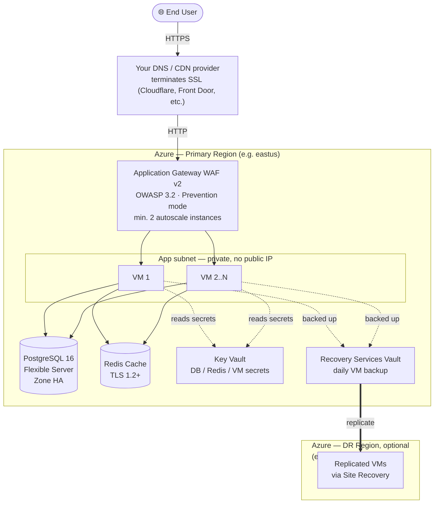

# azure-infra-quickstart

> Production-ready Azure infrastructure for multiple industries.  
> Fill 9 variables → `terraform apply` → live infrastructure in under 1 hour.

[](https://terraform.io)
[](https://registry.terraform.io/providers/hashicorp/azurerm/latest)
[](LICENSE)

---

## What This Repo Does

This is a Terraform template that stands up a complete, secured, production-grade
application stack on Azure — load balancer/WAF, VMs, database, cache, secrets
management, backups, and cross-region disaster recovery — from a single
`terraform.tfvars` file. It replaces weeks of hand-rolling networking, security,
and Day-2 operational plumbing with a `terraform apply`.

Everything is named and tagged from two values (`customer` + `environment`), so
the same code deploys isolated, identically-shaped infrastructure for as many
brands/clients/environments as you need, without copy-pasting `.tf` files.

## Who It's For

- **DevOps / Platform engineers** who need a secure-by-default Azure landing
  zone (private subnets, NSGs, WAF, no public VM access) without designing one
  from scratch for every new project.
- **Agencies and consultancies** standing up the same class of stack repeatedly
  for different clients — the `customer`/`environment` naming convention exists
  specifically for this multi-tenant reuse case.
- **Small teams that need production posture on day one** — backups, DR
  replication, and centralized secrets are built in rather than bolted on
  after an incident.
- **Not a fit for**: teams needing a bespoke/non-standard architecture, or
  deployments outside Azure.

---

## How Resource Names Work

Set `customer = "adidas"` and `environment = "prod"` and every resource is named for you:

```
adidas-prod-rg         ← resource group
adidas-prod-vnet       ← virtual network
adidas-prod-vm1        ← application VM
adidas-prod-agw        ← application gateway
adidas-prod-psql       ← postgresql server
adidas-prod-redis      ← redis cache
```

Change `customer = "nike"` and everything renames consistently.

---

## Available Verticals

| Vertical | Folder | Status |
|---|---|---|
| E-commerce | `verticals/ecommerce/` | ✅ Ready |
| Hospital / Healthcare | `verticals/hospital/` | 🔜 Coming soon |
| SaaS Platform | `verticals/saas/` | 🔜 Coming soon |
| Fintech | `verticals/fintech/` | 🔜 Coming soon |

---

## Architecture — E-commerce



<details>
<summary>Plain-text version (if Mermaid doesn't render for you)</summary>

```
Internet
    │  Your DNS/CDN provider (Cloudflare, Front Door, etc.)
    │  terminates SSL here and forwards HTTP to the origin below
    ▼
Application Gateway WAF v2  (HTTP, port 80)
    │  OWASP 3.2 Prevention mode
    │  Min. 2 autoscale instances (no zone redundancy — see cost note below)
    ▼
Linux VMs (Ubuntu 24.04 LTS)
    │  Private subnet only · No public IP
    │  Backed up daily · Replicated to a DR region via Site Recovery (optional)
    ├──▶  PostgreSQL 16 Flexible Server
    │       Private · Zone HA · SSL enforced
    ├──▶  Redis Cache
    │       Private endpoint · TLS 1.2+
    └──▶  Key Vault
            Private endpoint · DB/Redis/VM secrets
```

</details>

---

## Quick Start

### Prerequisites

```bash
# 1. Install Terraform ≥ 1.9
brew install terraform                      # macOS
winget install Hashicorp.Terraform          # Windows
sudo apt install terraform                  # Ubuntu

# 2. Install Azure CLI and login
curl -sL https://aka.ms/InstallAzureCLIDeb | sudo bash
az login
az account set --subscription "<YOUR_SUBSCRIPTION_ID>"

# 3. Generate SSH key (if you don't have one)
ssh-keygen -t rsa -b 4096 -f ~/.ssh/id_rsa
```

### Deploy E-commerce

```bash
# Clone
git clone https://github.com/YOUR_USERNAME/azure-infra-quickstart.git
cd azure-infra-quickstart/verticals/ecommerce

# Configure
cp terraform.tfvars.example terraform.tfvars
nano terraform.tfvars          # fill in your 9 values

# Deploy
terraform init
terraform plan                 # review changes
terraform apply                # type 'yes' to confirm
```

---

## The 9 Variables

Open `terraform.tfvars` and fill these values:

| Variable | Description | Example |
|---|---|---|
| `customer` | Brand/company name — drives all resource names | `adidas` |
| `environment` | Deployment environment | `prod` |
| `location` | Azure region | `eastus` |
| `domain_name` | Your domain — point its DNS/CDN origin at the AGW IP and terminate SSL there | `adidas.com` |
| `size` | Infrastructure size tier | `small` |
| `vm_admin_username` | Linux VM login username | `azureuser` |
| `vm_ssh_public_key` | Your SSH public key | `ssh-rsa AAAA...` |
| `db_admin_username` | PostgreSQL admin username | `psqladmin` |
| `db_admin_password` | PostgreSQL admin password | `YourStr0ng!Pass` |

---

## Size Presets

| Size | Est. Monthly | VM SKU | DB SKU | Redis | Best For |
|---|---|---|---|---|---|
| `small` | ~$440/mo | Standard_B2s_v2 × 1 | B_Standard_B2s | Basic C0 | Startup, <10k users |
| `medium` | ~$1,020/mo | Standard_D4s_v5 × 2 | GP_Standard_D4s_v5 | Standard C1 | Growing, <100k users |
| `large` | ~$2,310/mo | Standard_E8s_v5 × 3 | GP_Standard_D8s_v5 | Standard C2 | Enterprise, <1M users |

Includes Key Vault, VM backups, and Site Recovery cross-region replication.
Set `enable_dr_replication = false` to drop the replication cost (~$40–115/mo
depending on size) — see [docs/cost-estimates.md](docs/cost-estimates.md) for
the full breakdown.

---

## What Gets Deployed

### Networking
- Virtual network `10.0.0.0/16` with 5 isolated subnets
- AGW subnet `10.0.1.0/24` — Application Gateway only
- App subnet `10.0.2.0/24` — VMs only
- DB subnet `10.0.3.0/24` — PostgreSQL only (delegated)
- Redis subnet `10.0.4.0/24` — Redis only
- Key Vault subnet `10.0.6.0/28` — Key Vault private endpoint only
- NSGs: deny-all by default, explicit allow rules only
- Private DNS zones for PostgreSQL, Redis, and Key Vault

### Compute
- Application Gateway WAF v2 (OWASP 3.2, Prevention mode, min. 2 autoscale instances — not zone-redundant, see [cost note](docs/cost-estimates.md))
- Linux VMs Ubuntu 24.04 LTS (zone spread, auto-patching, no public IP)
- Serves plain HTTP — terminate SSL at your DNS/CDN provider in front of it
- Health probe on `/health`

### Database
- PostgreSQL 16 Flexible Server (zone-redundant HA, private only, SSL enforced)
- Redis Cache with private endpoint (TLS 1.2+, no public access)

### Secrets
- Key Vault (RBAC-authorized, private endpoint only, no public network access)
- Stores: DB admin username/password, DB connection string, Redis hostname/key, VM admin username, VM SSH public key

### Backup & Disaster Recovery
- Recovery Services Vault with a daily VM backup policy (30 daily / 12 weekly / 12 monthly retention) — always on
- Azure Site Recovery cross-region VM replication to a secondary region — on by default, toggle off with `enable_dr_replication = false`
- See [docs/disaster-recovery.md](docs/disaster-recovery.md) for restore and failover steps

---

## VM Access

VMs have no public IP. You decide how to connect:

**Option A — VPN Gateway** (recommended for teams)
Add a VPN Gateway to the VNet and connect your office/laptop via site-to-site or point-to-site VPN.

**Option B — Jump host / Bastion VM**
Deploy a small VM with a public IP in the AGW subnet and SSH through it.

**Option C — Azure Bastion** (simplest, browser-based)
Add the `AzureBastionSubnet` (`10.0.5.0/26`) and `azurerm_bastion_host` resource. See docs/vm-access.md.

To add SSH access from your IP temporarily, add this rule to the VM NSG:
```hcl
security_rule {
  name                   = "AllowSSHFromMyIP"
  priority               = 200
  direction              = "Inbound"
  access                 = "Allow"
  protocol               = "Tcp"
  source_port_range      = "*"
  destination_port_range = "22"
  source_address_prefix  = "YOUR.IP.ADDRESS/32"
  destination_address_prefix = "*"
}
```

---

## Traffic Flow

```
User → adidas.com (HTTPS)
     → Your DNS/CDN provider terminates SSL and forwards HTTP to the origin
     → App Gateway public IP (HTTP)
     → WAF v2 inspects (blocks OWASP Top 10 attacks)
     → Health probe confirms VM is alive
     → Routes to VM in backend pool
     → VM queries PostgreSQL and Redis privately
     → Response returned to user
```

---

## Folder Structure

```
azure-infra-quickstart/
├── README.md
├── .gitignore
├── modules/
│   ├── networking/          VNet, subnets, NSGs, private DNS
│   ├── compute/             VMs, Application Gateway WAF v2
│   ├── database/            PostgreSQL 16, Redis Cache
│   ├── keyvault/            Key Vault + DB/Redis/VM secrets
│   └── recovery/            Recovery Services Vault, VM backup, Site Recovery DR
├── verticals/
│   └── ecommerce/
│       ├── main.tf
│       ├── variables.tf
│       ├── outputs.tf
│       └── terraform.tfvars.example   ← copy this, fill 9 values
└── docs/
    ├── cost-estimates.md
    ├── post-deploy.md
    └── disaster-recovery.md
```

---

## Destroy

```bash
# Step 1: Remove the CanNotDelete lock
az lock delete \
  --name adidas-prod-lock \
  --resource-group adidas-prod-rg

# Step 2: Destroy all resources (also tears down the DR region resource
# group/replication if enable_dr_replication was true — it carries no lock)
terraform destroy
```

---

## License

MIT — free to use, modify, and deploy commercially.

---

*Built by [Naveen](https://github.com/naveen-devops) — Azure & DevOps Engineer*
